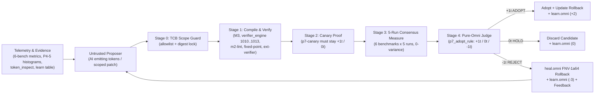

# Omni Closed-Loop Proposer Design (`spec/m7/PROPOSER_LOOP_DESIGN.md`)

**Status:** Proposal (Design Only — **no implementation until agreed**)  
**Base:** `main@19a448d` (Phase 7 `P7-0`–`P7-3`, New-Level API Stages `1`–`2.5`, Seed-Shrink Phases `A`–`C`, Flywheel Rounds `1`–`2`)

---

## 1. Problem Statement

Omni already has the **eyes** (`pure/m7/judge.omni`, 6-benchmark corpus including `bench_verifier_engine`, P4-5 binary trace ring, 5-run consensus, canary proof), the **hands** (`pure/api/reflect.omni`, `pure/api/emit.omni`, `pure/api/adaptive.omni`), the **immune system** (`pure/m7/heal.omni`), and **memory** (`pure/m7/learn.omni`).

What is still manual is the **proposer**: a human currently inspects metrics, decides which pass to write, edits source/tokens, and triggers the gates. Closing the flywheel means replacing manual pass authoring with an **unprivileged AI proposer** that emits candidate token streams or scoped subsystem patches into an **immutable, fail-closed verification and judgment pipeline**.

---

## 2. Trust Boundary: Untrusted Proposer vs. Immutable TCB

The single most important invariant is **strict separation of generation from verification**:

- **Proposer (Untrusted):** Allowed to read metrics, trace histograms, `api_token_inspect` summaries, `p7_learn_rank_best` scores, and target subsystem code/tokens; allowed to emit candidate bytes/patches into a sandboxed scratch buffer or isolated git worktree. **Has zero authority to modify gates, skip checks, relax thresholds, or commit directly to `main`.**
- **TCB Gate & Judge (Trusted, Deterministic, Zero-AI):** Pure-Omni + Stage-0 host harness that mechanically enforces scope, runs verification, proves the canary, measures 5-run consensus, and executes the balanced-ternary adopt/hold/reject decision.

---

## 3. How the Loop Proposes Candidate Passes (AI Emitting Tokens)

The proposer operates in **two tiers**, matching Omni's existing reflective API and compiler architecture:

### Tier 1 — Direct Token-Stream Proposals (`.omni_bc`, Pure-Omni Reflective Path)

Used for peephole rewrites, dead-op elimination, constant folding, and specialized hot-path streams without touching `.omni` compiler source:

1. **Observe:** The TCB invokes `pure/api/reflect.omni::api_token_inspect(module_bc)` and `api_token_inspect_trace(trace_ring)` alongside `pure/m7/learn.omni::p7_learn_rank_best(table, profile, cap_mask)` and serializes a compact, deterministic observation packet:
   - Target function token stream (`.omni_bc` `u16` words) and structural summary `(n_fns, total_ins, n_words)`.
   - Live P4-5 4-class opcode histogram (`alu`, `mem`, `ctrl`, `call_ret`) and workload profile (`IDLE/ALU/MEM/CTRL/CALL`).
   - Current subsystem attribution mask (`p7_attribute_subsystem`) and top-ranked policy hints from `learn.omni`.
   - Prior rejection diagnostics (verifier error codes, `m2-lint` findings, or regression deltas) from the current bounded episode (`attempt < max_attempts`).
2. **Propose (AI Emits Tokens):** The AI proposer outputs either:
   - **Direct token emission:** A candidate `.omni_bc` token stream (`u16` words, valid `TOK_MOD_BEGIN .. TOK_MOD_END`), validated structurally via `pure/api/emit.omni::api_token_emit(cand_bc)`, **or**
   - **Parameterized specialization:** A policy/hint vector passed to `pure/api/reflect.omni::api_token_specialize` / `pure/api/adaptive.omni::api_specialize_with_hint` (which can be extended with new verified Pure-Omni rewrite passes over time).
3. **Why tokens directly?** Omni's `.omni_bc` ISA is fixed (128 opcodes, zero ambiguity, deterministic decoder, single-pass linear/capability/taint verifier). Emitting tokens directly eliminates parser ambiguity and lets `pure/verifier_engine.omni` reject ill-typed, unsafe, or capability-violating proposals in milliseconds before execution.

### Tier 2 — Scoped Compiler/VM Pass Proposals (`.omni` Source Path)

Used for structural improvements to the self-hosted toolchain itself (e.g., **M3 frontend** `pure/m3/*.omni`, **M4 VM** `pure/m4/*.omni`, or **M2 multi-emitter** `pure/m2/emit_multi.omni`):

1. **Target Selection (Data-Driven):** The TCB selects **exactly one** mutable target subsystem from the 6-benchmark telemetry (e.g., `M3_FRONTEND` when `bench_verifier_engine.compile_us` dominates, `M4_VM` when `vm_us` dominates, `M2_EMITTER` only when `elf_bytes` headroom justifies seed growth).
2. **Single-Subsystem Constraint:** Each proposal MUST declare a single `target_subsystem` (`M3_FRONTEND`, `M2_EMITTER`, or `M4_VM`) and may touch **only** the allowlisted files for that subsystem. Mixing subsystems in one proposal is rejected at Stage 0 so `p7_attribute_subsystem` remains diagnostic and clean.
3. **Seed Regeneration Rule:** If a Tier-2 proposal edits `pure/m3/*.omni`, `pure/m2/*.omni`, or `pure/m4/*.omni`, the TCB—never the proposer—rebuilds the corresponding `.omni_bc` seed in the isolated sandbox and verifies fixed-point parity (`0`-word / `0`-byte diff).

---

## 4. Gating Pipeline (`compile → gate → measure → adopt/reject`)

Every candidate proposal passes through five sequential, fail-closed stages. Failure at **any** stage immediately short-circuits to `-1t (REJECT)`.

### Stage 0 — TCB Scope & Integrity Guard (Pre-Compile)

- Verify every modified path is inside the active `target_subsystem` allowlist and outside the **Immutable Deny-List** (§5).
- Snapshot SHA-256 / FNV-1a64 digests of all deny-listed files **before** and **after** proposal generation; any drift triggers `FATAL_ABORT` (`err_code = 10`, `VERIFIER_TAMPER` in `pure/m7/heal.omni`).
- Enforce proposal size caps (max diff lines / max token count) and capability budget (`cap_mask`, zero host I/O, no `serve`/`repair_cmd`/shell).

### Stage 1 — Compile, Verify, Lint & Fixed-Point Gates

- **Tier 1 (Tokens):**
  1. `api_token_emit(cand_bc)` returns non-empty canonical bytes.
  2. `pure/verifier_engine.omni::omni_verify_module_api(cand_bc)` passes with `0` errors (including Stage-1 API rules `1010` `MISSING_CAP_TERNARY`, `1011` `TAINT_ON_CONSENSUS`, `1012` `LINEAR_REFLECT`, `1013` `CAP_NARROW_EXPAND`).
  3. Cross-check against frozen Rust verifier (`verify_binary_function`) and independent Python checker (`scripts/external_verifier_check.py`).
  4. Semantic equivalence check: M2-multi ELF64 lowering + M4 VM execution + native Linux x86-64 execution produce identical `ret_val` across all benchmark inputs.
- **Tier 2 (Subsystem Source):**
  1. Pure-Omni M3 compile (`pure_default_compile_surface_to_u16`) succeeds with `0` errors and `0` warnings.
  2. `m2-lint` passes with `0` gated findings (`<= 120` SSA regs, `<= 12` labels, `<= 1` `anew(0)`/module, `LINEAR_BYTES` clean, zero recursion, zero dynamic `IDIV`/`IMOD`, zero `@PACK5` opcodes).
  3. Fixed-point & parity gates pass (`m3-fixed-point`, `m2-fixed-point`, `p5-selfhost`, `m2-frozen`, `b2-pure-verifier`, `b4-pure-launcher`, full `selftest`).
  4. On Linux CI: `scripts/zero_rust_rebuild.sh` (`S1 == S2 == S3 == V` with `rustc`/`cargo` absent from `PATH`).

### Stage 2 — Canary Proof (Must Stay `+1t` / `0t`)

Before the candidate is allowed to be judged, the measurement apparatus itself must pass **`omnic p7-canary`** on the full **6-benchmark corpus** (`bench_clamp`, `bench_loop_sum`, `bench_branch_tree`, `bench_multi_call`, `bench_arena_buf`, `bench_verifier_engine`):

- **Canary A (Known-Good M2 tweak `CanaryZeroImm`):** MUST still judge **`+1t` (ADOPT)** across 5 runs, strictly attributed to `M2_EMITTER (2)`, with exact `8 * zero_loads` byte reduction and zero trace-histogram drift.
- **Canary B (Known-Neutral comment/whitespace):** MUST still judge **`0t` (HOLD)** across 5 runs, attributed to `NONE (0)`.
- **Frozen hashes:** All 5 frozen FNV-1a64 hashes (`m2-frozen`) MUST remain identical.
- If `p7-canary` fails or drifts from `+1t`/`0t`, the proposal is **immediately rejected** and the loop halts (never judge a candidate with a broken ruler).

### Stage 3 — 5-Run Consensus Measurement

Run baseline vs. candidate across all **6 benchmarks × 5 repeated runs** (collecting `compile_us`, `emit_us`, `vm_us`, `bc_words`, `elf_bytes`, `vm_steps`, `trace_ops`, `arena_bytes`, and 4-class trace histograms):

- **Zero-variance check:** All deterministic metrics (`bc_words`, `elf_bytes`, `vm_steps`, `trace_ops`, `arena_bytes`, `hist_*`) MUST have `0` variance across all 5 runs.
- **Noisy timing metrics (`compile_us`, `vm_us`):** Judged strictly through `pure/m7/judge.omni::p7_judge_5runs(b0..c4, band)` (balanced-ternary 5-run majority vote with an explicit division-free noise band `band`, e.g., 5% of baseline median or a fixed microsecond floor, computed as plain `i64` before crossing into `{-1t, 0t, +1t}`).
- **Seed-bloat guard:** For compiler/VM passes, the regenerated seed size (`m3.omni_bc` / `m2.omni_bc` / `m4.omni_bc` words) is included as a tracked metric so a tiny win cannot be bought by unbounded seed bloat.

### Stage 4 — Balanced-Ternary Adopt / Hold / Reject + Heal & Learn

All 6 benchmark verdicts are combined via `pure/m7/judge.omni` (`p7_aggregate_suite5` chained to 6 + `p7_adopt_rule(gates_ok, suite_verdict)`):

| Verdict | Condition | Action |
| :---: | :--- | :--- |
| **`+1t` (ADOPT)** | `gates_ok == 1`, canary `+1t`/`0t`, **zero** benchmark regresses (`-1t`), **at least one** benchmark improves (`+1t`), and `p7_attribute_subsystem` matches declared target | Record win in `pure/m7/learn.omni` (`+2`), update FNV-1a64 `P7RollbackTarget`, stage/commit candidate (or open PR for human merge in Phase L2) |
| **`0t` (HOLD)** | `gates_ok == 1`, canary `+1t`/`0t`, all 6 benchmarks neutral (`0t`) | Discard candidate (neutral is never adopted), record neutral in `learn.omni`, retain baseline |
| **`-1t` (REJECT)** | Any gate fails, canary drifts, or **any** of the 6 benchmarks regresses (`-1t`) | Invoke `pure/m7/heal.omni::p7_heal_decide` → FNV-1a64-verified rollback, log 16-B entry, record loss in `learn.omni` (`-3` safety-biased penalty), return structured diagnostic to proposer (bounded `max_attempts = 3`; immediate `FATAL_ABORT` on fault codes `10..13`) |

---

## 5. Immutable Deny-List (What the Proposer Is NEVER Allowed to Touch)

The proposer is **mechanically prevented** (by TCB path allowlist + pre/post digest check, never by prompt convention alone) from modifying any of the following:

1. **The Verifier & Independent Checker (Highest Priority):**
   - `pure/verifier_engine.omni` (and its lock TSVs `spec/m2/single_mode_lock.tsv`, `spec/m2/shape_census.tsv`, `spec/m3/corpus.tsv`)
   - Frozen Rust verifier (`verify_binary_function` in `omni_rust_bootstrap.rs` and `omni-workspace/`)
   - `scripts/external_verifier_check.py` and `spec/verifier_traces/*`
2. **The Judge, Canary & Measurement Harness:**
   - `pure/m7/judge.omni` and `spec/m7/judge_harness.omni`
   - `selftest_p7_0_measure`, `selftest_p7_0a_canary`, `P7_BENCHMARK_CORPUS`, `p7_benchmark_corpus_all`, and expected benchmark outputs / noise-band policy
3. **Self-Healing Safety & Rollback Engine:**
   - `pure/m7/heal.omni` (fatal taxonomy `10..13`, `P7RollbackTarget` FNV-1a64 verification, bounded retry cap)
4. **ISA & Frozen ABI Contracts:**
   - 128-opcode table (`pure/isa/table.omni`, zero renumbering)
   - Single-mode x86-64 emitter (`pure/m2/emit_x86.omni`) and all 5 frozen FNV-1a64 hashes (`selftest_m2_frozen_hashes`)
5. **Stage-0 Seed, Zero-Rust Gate, CI & Capability Model:**
   - `seed0/omni_seed0.rs`, `p4_shim/mod.rs`, `pure/m5/launcher.omni`
   - `scripts/zero_rust_rebuild.sh`, `.github/workflows/ci.yml`
   - Capability-gating & quarantine rules (`error[ORACLE_ONLY_MACRO]`, no `serve` / `repair_cmd` / shell / network I/O in Pure-Omni)

### Mutable Target Allowlist (One Subsystem Per Proposal)

- `M3_FRONTEND`: `pure/m3/*.omni` (plus TCB-regenerated `pure/m3/m3.omni_bc`)
- `M4_VM`: `pure/m4/*.omni` (plus TCB-regenerated `pure/m4/m4.omni_bc`)
- `M2_EMITTER`: `pure/m2/emit_multi.omni` (plus lockstep oracle mirrors and TCB-regenerated `pure/m2/m2.omni_bc`, only when explicitly unlocked)
- `TIER1_TOKENS`: In-memory `.omni_bc` buffers passed to `api_token_inspect` / `api_token_specialize` / `api_token_emit` (zero disk writes until `+1t` ADOPT)

---

## 6. Phased Rollout & Open Decisions for Agreement

No code will be written until the following design choices are agreed:

1. **Rollout Order:**
   - **L1 (Token-Level Loop):** Wire an external AI proposer to emit Tier-1 `.omni_bc` token streams through `api_token_emit → omni_verify_module_api → p7-canary → 5-run measure → p7_adopt_rule` on a single benchmark function first.
   - **L2 (Scoped Source Loop — PR-Gated):** Extend to Tier-2 single-subsystem patches (starting with `M3_FRONTEND` once `bench_verifier_engine` is proven), where `+1t (ADOPT)` opens a branch/PR for human merge rather than pushing directly to `main`.
   - **L3 (Autonomous Branch Loop):** Bounded multi-episode loop (e.g., max 3 proposals per run) backed by `pure/m7/learn.omni` persistence and `pure/m7/heal.omni` rollback logs.
2. **Questions to Confirm Before Implementation:**
   - **Q1 (Noise Band for `compile_us` / `vm_us`):** Should timing metrics require a minimum relative improvement (e.g., `>= 5%` across 5-run consensus) to count as `+1t`, while deterministic metrics (`bc_words`, `elf_bytes`, `vm_steps`, `arena_bytes`) stay at `band = 0`?
   - **Q2 (Seed-Size Budget):** Should a Tier-2 pass that speeds up `compile_us` by e.g. `15%` be allowed to grow `m3.omni_bc` by up to a bounded cap (e.g., `<= 5%`), or must `bc_words` never regress?
   - **Q3 (Adoption Target in L2):** Should `+1t (ADOPT)` automatically open a PR (human merges) or auto-commit to a dedicated `flywheel/auto` branch?
